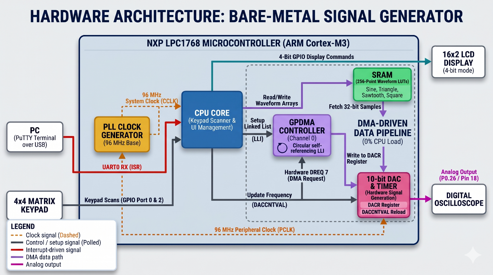
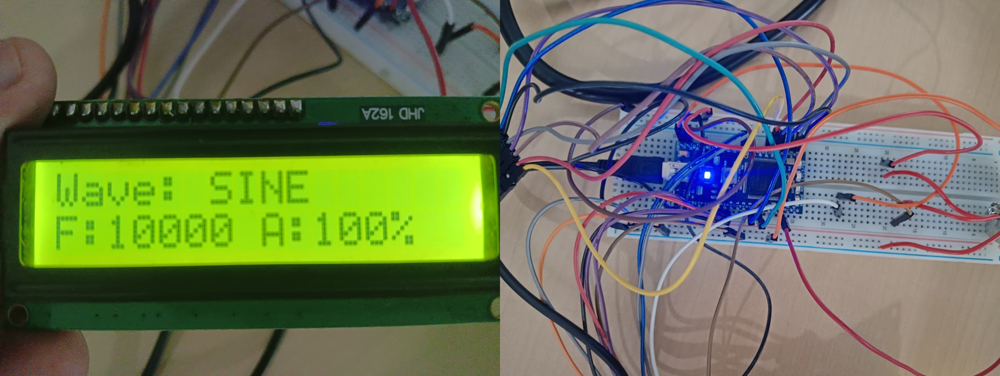
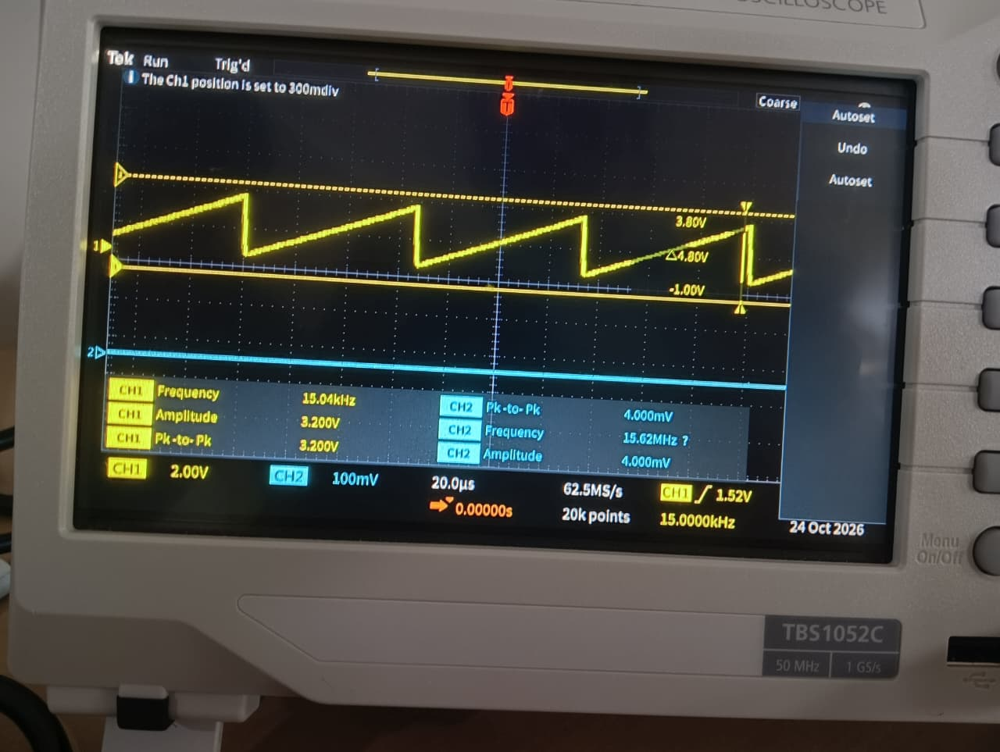
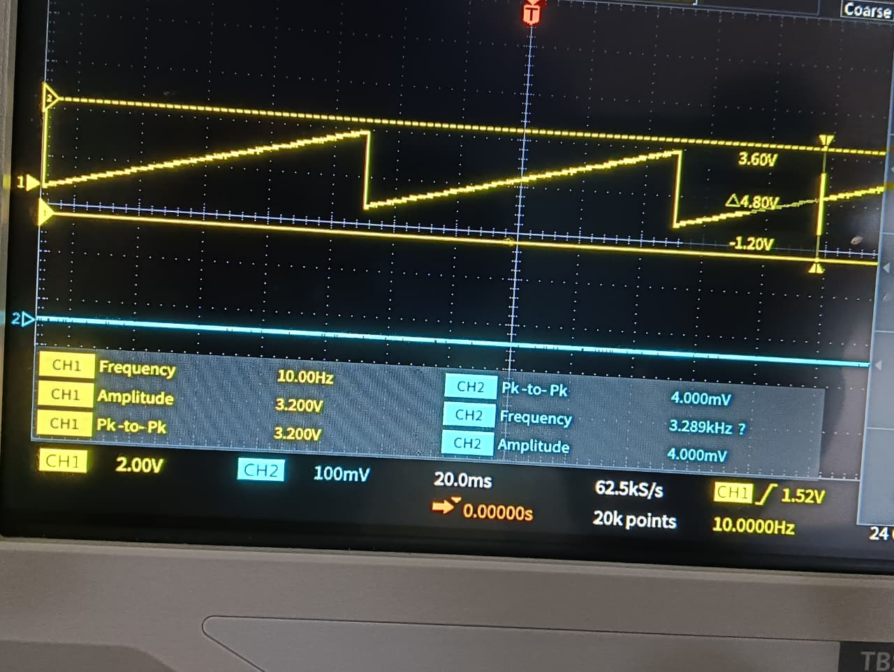

# Digital Function Generator — NXP LPC1768 (Bare-Metal ARM Cortex-M3)

A 4-waveform digital function generator built on the NXP LPC1768, written entirely in
bare-metal, register-level C (no CMSIS drivers, no RTOS, no vendor HAL). The output path
runs on the GPDMA controller and the on-chip 10-bit DAC with zero CPU involvement once
started; the CPU's only job is to service a keypad/LCD front panel and a UART command
interface, neither of which ever touches the DAC or DMA registers directly.

Built for the Microprocessor Lab mini-project, Dept. of ECE, Manipal Institute of
Technology (Oct 2026). Full writeup, including the test results below, is in
[`docs/report.pdf`](docs/report.pdf).

## Features

- **Waveforms:** sine, triangle, sawtooth, square — 256-point, 10-bit look-up tables
- **Frequency:** 10 Hz – 15 kHz, set via the DAC's own hardware timeout counter (`DACCNTVAL`), not a CPU delay loop
- **Amplitude:** 10% – 100% of full scale, in 10% steps, applied digitally before the DMA buffer is built
- **Local control:** 4×4 matrix keypad + 16×2 character LCD (4-bit mode)
- **Remote control:** UART0 at 115200 baud, interrupt-driven, short text commands (`F15000`, `W2`, `A9`, ...) from any serial terminal
- **Deterministic output:** waveform streaming runs entirely on GPDMA (circular, self-referencing linked list); neither the keypad/LCD polling loop nor the UART RX interrupt ever write to `LPC_DAC` or `LPC_GPDMACH0` directly

## Block diagram



## How it works

**Clock.** `SystemClock_Force96MHz()` switches off the internal RC oscillator, selects the
12 MHz external crystal, and drives PLL0 up to a 96 MHz CPU/peripheral clock.

**Waveform output (the data path).** Each waveform is a pre-computed 256-point, 10-bit
table (`waveforms.h`) — the sine table samples `sin(2·π·n/256)` scaled about mid-scale
(512), triangle/sawtooth are linear ramps, square is a two-level step. When a setting
changes, `DAC_DMA_Start()` rebuilds a 32-bit SRAM buffer from the selected table (scaling
each sample by the current amplitude level), then programs a single GPDMA linked-list item
whose `NextLLI` points back to itself — so once channel 0 is enabled, the controller keeps
re-reading its own descriptor and streaming the buffer to `DACR` forever, with no further
CPU involvement. `DAC_SetFrequency()` derives the DAC's internal reload count from
`96,000,000 / (target_frequency × 256)`.

**Local control (keypad + LCD).** The main loop polls a 4×4 matrix keypad by driving one
row low at a time and reading the four column inputs, and refreshes the LCD only when the
displayed waveform, frequency or amplitude actually changes. A keypress never writes to the
DAC/DMA registers itself — it updates a state variable and calls `DAC_DMA_Start()` again.

**Remote control (UART0).** `UART0_IRQHandler()` is a genuine hardware RX interrupt (not
polled): it buffers incoming characters and, on `\r`/`\n`, flags a complete line for the
main loop to parse with `atoi()`. Because the ISR only ever touches `rx_buffer` /
`rx_index` / `command_ready`, UART reception and DMA-driven waveform output are on
completely independent paths.

An earlier prototype drove waveform switching from a single GPIO pin configured as a
rising-edge interrupt — it worked, but a single pin can only step through a fixed sequence
and can't address three independent parameters, which is why the keypad replaced it for
local control once frequency and amplitude were added. The commit history reflects this
progression: GPIO-interrupt prototype → keypad + amplitude → UART remote control.

## Hardware

| Component | Detail |
|---|---|
| MCU | NXP LPC1768 (ARM Cortex-M3), run at 96 MHz |
| DAC | On-chip 10-bit, output on P0.26 (AOUT) |
| Display | 16×2 HD44780-compatible LCD, 4-bit mode |
| Input | 4×4 matrix keypad |
| Host link | UART0, 115200 8-N-1, over the board's on-board USB-to-serial interface |
| Oscillator | 12 MHz external crystal |

**Pin map**

| Signal | Pin(s) |
|---|---|
| DAC output (AOUT) | P0.26 |
| UART0 TXD0 / RXD0 | P0.2 / P0.3 |
| LCD RS / EN | P0.0 / P0.7 |
| LCD D4–D7 | P0.4, P0.5, P0.6, P0.9 |
| Keypad rows (output) | P2.0 – P2.3 |
| Keypad columns (input, pull-up) | P2.4, P2.5, P0.15, P0.16 |

## Repository layout

```
.
├── Src/                  main.c, dac.c
├── Inc/                  dac.h, waveforms.h
├── startup/              startup_LPC17xx.s (stock Keil/CMSIS startup)
├── keil-project/         exp02.uvproj, exp02.sct — open exp02.uvproj in Keil µVision
└── docs/
    ├── report.pdf        full mini-project report (methodology, results, references)
    └── images/           block diagram + oscilloscope/hardware photos used below
```

Build artifacts (`.o`, `.axf`, `.hex`, `.map`, IDE cache files, ...) are intentionally not
checked in — see `.gitignore`.

## Building

1. Install Keil MDK-ARM (any recent version with LPC17xx device support).
2. Open `keil-project/exp02.uvproj`.
3. Build (F7) and flash (F8) to an LPC1768 board over its on-board debugger.

No external libraries are required — everything is direct register access via the CMSIS
`LPC17xx.h` device header that ships with the LPC17xx device pack.

## Usage

**Keypad**

| Key | Action | Key | Action |
|---|---|---|---|
| `1` | Sine | `7`–`9`, `*`, `0`, `#` | unused |
| `2` | Triangle | `A` | Frequency +500 Hz |
| `3` | Sawtooth | `B` | Frequency −500 Hz |
| `4` | Square | `C` | Amplitude +10% |
| `5`, `6` | unused | `D` | Amplitude −10% |

**UART (115200 8-N-1)** — send a line ending in `\r` or `\n`:

| Command | Effect |
|---|---|
| `F<freq>` | Set frequency, e.g. `F15000` → 15 kHz (clamped to 10 Hz–15 kHz) |
| `W<n>` | Set waveform: `1`=sine, `2`=triangle, `3`=sawtooth, `4`=square, e.g. `W2` |
| `A<n>` | Set amplitude, `1`–`10` → 10%–100%, e.g. `A9` → 90% |

## Results

Hardware setup and LCD readout, and the sawtooth output captured at the two ends of the
supported frequency range:





A close match was observed between the requested and measured frequency for all four
waveforms across the tested range (full table and discussion in the report). The 10 Hz–15
kHz range is a firmware-imposed ceiling, not a measured hardware failure point — at 15 kHz
the DAC must accept a new sample roughly every 260 ns (3.84 MSPS), which was kept as a
conservative margin against the DAC's settling time and the GPDMA/AHB bus timing rather
than pushed to failure.

## Future work

- Extend the UART interface to accept a full arbitrary waveform upload, instead of
  selecting among the four built-in shapes.
- Add an external op-amp stage at the DAC output for true variable-gain, bipolar
  (negative-swing) amplitude control — the current amplitude control is a digital scale of
  the existing 0–3.3 V unipolar DAC output.

## References

1. NXP Semiconductors, *LPC1769/68/67/66/65/64 User Manual (UM10360)*, April 2014.
2. ARM Limited, *Cortex-M3 Technical Reference Manual, Revision r2p1*, ARM DDI 0337I, 2010.
3. Hitachi Ltd., *HD44780U (LCD-II) Dot Matrix Liquid Crystal Display Controller/Driver*, Rev. 0.0, ADE-207-272(Z), Sept. 1999.
4. J. W. Valvano, *Embedded Systems: Real-Time Interfacing to ARM Cortex-M Microcontrollers*, Vol. 2, 4th ed., 2014, ISBN 978-1463590154.
5. W. Kester, *Tutorial MT-085: Fundamentals of Direct Digital Synthesis (DDS)*, Analog Devices, Inc., 2009.

## Authors

Nagendra Kudva, Ruthvik K S, Sandeep Ryan, Pratham — Dept. of Electronics and Communication
Engineering, Manipal Institute of Technology.

## License

[MIT](LICENSE)
